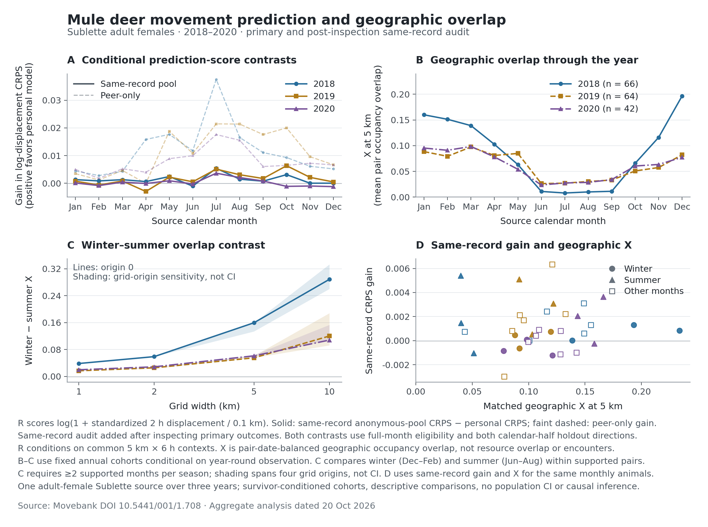

# Mule deer: seasonal geographic sharing and conditional movement differences

**Completed exploratory source analysis, 20 October 2026.** One source-labeled
Sublette herd, adult females, 2018–2020. This extends the database programme with
36 paired monthly movement/geography observations and annual constant-cohort
controls. It is not a cross-taxon generality or resource-partitioning result.

## Main findings

The same annually tracked animals share more geographic space in winter than
summer. The direction holds in **all 48 declared year × grid-width × origin
settings**. These are sensitivity settings within three reused years, not 48
independent replications. Absolute overlap is low for most pairs and changes
substantially with spatial resolution.

Movement comparisons require an additional distinction. The original heldout
personal model beats a peer-only model in **35 of 36 months**, but this comparison
also adds the focal animal's training records. Against an anonymous model using
**exactly the same records**, the personal weighting rule wins in **27 of 36
months**, with a much smaller average gain. Within the same seasonally observed
animals, the same-record gain averages slightly below zero in winter and above
zero in summer in each of the three years. This is a descriptive seasonal pattern
in conditional displacement models, not proof that individuality causes spatial
separation or that individual strategies are universal.



## 1. Source and observation support

Original source: Wilde, Monteith and Kauffman, [Movebank DOI
10.5441/001/1.708](https://doi.org/10.5441/001/1.708), CC0. Both original GPS and
reference files match the publisher MD5 values and the previously pinned SHA-256
receipts. Reference metadata identify 135 adult females in the Sublette Herd,
neck collars, capture by helicopter net-gunning and manipulation `none`. The
export has no individual migrant/resident labels, quantitative GPS error fields,
or usable deployment start/end dates. No association or common resource pool is
inferred merely from the herd label.

| Processing stage | Observations |
|---|---:|
| Complete original GPS source | 948,632 |
| Outside 2018–2020, excluded | 232 |
| Retained GPS fixes | 948,400 |
| Same-animal/tag/date/month 108–132-minute steps | 836,636 |
| Primary heldout steps inside common supported contexts | 343,879 |
| Primary months reported | 36 |
| Evaluated animals per primary month | 9–88 |

The final monthly R cohort must pass support in both calendar-half folds. It is
stricter than the earlier 38–99-animal coarse availability screen. Its test mask
retains 48.0–88.4% of all steps from those final monthly animals, 75.4% when step
counts are combined across months. These are not all 135 animals in every month.

All retained events match the original animal/tag reference pair; no conflicting
or duplicate animal timestamps remain. No speed filter was applied: four steps
exceed 10.8 km/h, none exceed 20 km/h, and the maximum is 18.44 km/h. Unquantified
source error remains a limitation. Times use the source's clock; the README
permits UTC or GPS time, so a verified UTC offset is not asserted.

## 2. Geographic sharing has a repeatable seasonal configuration

For each year, fix the cohort to animals with at least 80 fixes on 10 observed
dates in **every month**. This leaves 66, 64 and 42 animals. The cohort remains
unchanged within its year; animals can recur across years. Each dyad's occupancy
uses the same pair-shared dates, with equal date weights. Winter is December,
January and February within the calendar year; summer is June–August. A pair needs
at least two supported months per season. These are calendar windows, not fitted
migration-state labels.

| Year | Constant animals | Supported pairs | Winter X, 1 km | Summer X, 1 km | Winter X, 5 km | Summer X, 5 km |
|---|---:|---:|---:|---:|---:|---:|
| 2018 | 66 | 2,145 | 0.040648 | 0.002137 | 0.169215 | 0.009670 |
| 2019 | 64 | 2,016 | 0.022790 | 0.005907 | 0.083283 | 0.027888 |
| 2020 | 42 | 861 | 0.025494 | 0.005574 | 0.087878 | 0.026532 |

The winter-minus-summer mean is positive at 1, 2, 5 and 10 km for every declared
zero/half-cell grid origin. The magnitude is not scale free: for example, the
2018 difference ranges from about 0.039 at 1 km to 0.289 at the unshifted 10-km
grid. Therefore a single coarse-grid overlap value should not be interpreted as
a universal niche-sharing parameter.

The mean does not describe every animal pair. At 5 km, winter overlap exceeds
summer overlap in **66.0%, 43.5% and 41.7%** of pairs in 2018, 2019 and 2020.
The median pair difference is **0.0174, 0 and 0**, respectively. Thus the positive
herd-wide average can coexist with many pairs showing no difference and some
showing the opposite difference. A statement that the entire herd uniformly
mixes in winter would overstate these data. These spatial summaries alone do
not establish social subgroups or simultaneous encounters.

The constant cohort controls within-year animal turnover for X. It conditions on
long tracking survival and does not make the three annual cohorts equivalent.
No population confidence interval is inferred from treating dependent dyads as
independent replicates.

## 3. Movement differences: use the same-record benchmark for interpretation

The outcome is log(1 + standardized two-hour net displacement / 0.1 km), where
net displacement is the endpoint great-circle distance, standardized by actual
elapsed time. It is not traveled path length or a classification of resting,
feeding or migrating. Profiles condition on 5-km cells and 6-hour source-clock
bins. Dates and animals receive balanced weights. Train on one calendar half and
score the other, then reverse; every evaluated date is absent from its own fitted
model. This measures out-of-period distribution prediction and is not restricted
to future forecasting.

A lower continuous ranked probability score (CRPS) is better. The original
personal distribution shrinks the focal animal's profile toward the peer pool,
with focal weight d/(d+5), where d is the number of qualified training dates. The
peer pool excludes the focal animal. Because adding the focal training records
can improve prediction even under a common true distribution, a positive
peer-only gain is insufficient to establish a benefit from individual weighting.

The additive [same-record audit](DEER_EQUAL_DATA_AUDIT_2026_10_20.json) keeps the
original personal model, all records, all cohort masks and all test weights fixed.
It adds an anonymous pool that weights every qualified training animal equally,
including the focal animal. No threshold or favorable month is selected.

| Comparator contrast | Positive months | Mean across all 36 months |
|---|---:|---:|
| Peer-only CRPS − personal CRPS | 35/36 | +0.01034292 |
| Same-record anonymous-pool CRPS − personal CRPS | 27/36 | +0.00109314 |

Mean anonymous-pool CRPS is 0.355289; the second mean gain is
0.308% of that equal-month average score. This is a small
model-score advantage, not a percentage of explained behavior or ecological
partitioning. The algebraic difference between the two contrasts cannot isolate
a causal sample-size effect because mixture weights and estimation precision
also change. These units are transformed-displacement CRPS units, **not the
fox pilot's nats**; do not numerically pool those two endpoints.

This audit was added **after inspecting initial 2018 primary peer-gain outputs**.
The original outputs are preserved, and their peer/personal scores are reproduced
exactly in every audit month (maximum difference 0). The original design was
recorded locally before opening the primary R/X outputs and uploaded with the
results; neither step is independent preregistration.

### Paired winter–summer comparison of the same animals

Require each animal to have at least two R-estimable months in each season in a
year. Average months within animal, then compare its seasons. This gives:

| Year | Paired animals | Winter same-record gain | Summer same-record gain | Winter − summer |
|---|---:|---:|---:|---:|
| 2018 | 23 | -0.000396 | +0.001329 | -0.001725 |
| 2019 | 27 | -0.000353 | +0.003267 | -0.003621 |
| 2020 | 18 | -0.001145 | +0.002815 | -0.003960 |

The observed ordering is consistent across years: the personal weighting rule
adds little on average in winter and more in summer. Training precision, peer
membership and unmeasured habitat still change with season. The per-animal
contrast distributions include both signs; these are not significance tests.
The paired R cohorts differ from the larger annual constant-X cohorts above.
Monthly matched R/X uses exactly the same animals, but the two seasonal controls
do not establish a causal or individual-level relationship between R and X.

## 4. Complete primary monthly table

X below uses all GPS fixes in the month from the final R animals, with pair-date
balancing; it does not use the larger annual constant cohort. All months are
retained, including the negative model gains.

| Source month | R animals | Heldout steps | Peer-only gain | Same-record gain | Matched X, 5 km |
|---|---:|---:|---:|---:|---:|
| 2018-01 | 62 | 16,137 | +0.004437 | +0.001317 | 0.193276 |
| 2018-02 | 53 | 12,382 | +0.002789 | +0.000847 | 0.233627 |
| 2018-03 | 40 | 9,682 | +0.004322 | +0.001303 | 0.155229 |
| 2018-04 | 36 | 7,208 | +0.015823 | +0.000609 | 0.149203 |
| 2018-05 | 18 | 3,189 | +0.017653 | +0.002432 | 0.116088 |
| 2018-06 | 28 | 6,939 | +0.011754 | -0.001029 | 0.051175 |
| 2018-07 | 29 | 6,853 | +0.037512 | +0.005405 | 0.039842 |
| 2018-08 | 32 | 7,311 | +0.016535 | +0.001481 | 0.039948 |
| 2018-09 | 34 | 7,476 | +0.011083 | +0.000759 | 0.043228 |
| 2018-10 | 32 | 6,020 | +0.009292 | +0.003119 | 0.148927 |
| 2018-11 | 62 | 14,168 | +0.006134 | +0.000024 | 0.100474 |
| 2018-12 | 88 | 22,002 | +0.005186 | +0.000033 | 0.138568 |
| 2019-01 | 81 | 21,902 | +0.003472 | +0.000749 | 0.119608 |
| 2019-02 | 75 | 18,074 | +0.001200 | -0.000635 | 0.091923 |
| 2019-03 | 53 | 11,634 | +0.004644 | +0.000820 | 0.085329 |
| 2019-04 | 63 | 13,564 | -0.000057 | -0.002968 | 0.078272 |
| 2019-05 | 16 | 2,825 | +0.018770 | +0.002222 | 0.132716 |
| 2019-06 | 27 | 6,393 | +0.010788 | +0.000531 | 0.103208 |
| 2019-07 | 31 | 8,176 | +0.021451 | +0.005107 | 0.091636 |
| 2019-08 | 33 | 8,322 | +0.021379 | +0.003087 | 0.121773 |
| 2019-09 | 36 | 7,657 | +0.017595 | +0.001719 | 0.095484 |
| 2019-10 | 13 | 2,314 | +0.019990 | +0.006338 | 0.120876 |
| 2019-11 | 48 | 11,076 | +0.009598 | +0.002129 | 0.092097 |
| 2019-12 | 47 | 10,797 | +0.006662 | +0.000475 | 0.087788 |
| 2020-01 | 48 | 11,921 | +0.005008 | +0.000103 | 0.098465 |
| 2020-02 | 38 | 9,226 | +0.001767 | -0.000831 | 0.077707 |
| 2020-03 | 48 | 10,165 | +0.005240 | +0.000418 | 0.106416 |
| 2020-04 | 45 | 10,022 | +0.003994 | -0.000086 | 0.099522 |
| 2020-05 | 16 | 3,595 | +0.008882 | +0.000909 | 0.109153 |
| 2020-06 | 33 | 8,966 | +0.009956 | -0.000241 | 0.158062 |
| 2020-07 | 34 | 9,163 | +0.017597 | +0.003642 | 0.166178 |
| 2020-08 | 35 | 9,545 | +0.015533 | +0.002065 | 0.143506 |
| 2020-09 | 36 | 9,073 | +0.006047 | +0.000818 | 0.128333 |
| 2020-10 | 9 | 1,388 | +0.006460 | -0.001114 | 0.128125 |
| 2020-11 | 32 | 8,578 | +0.007238 | -0.000991 | 0.142496 |
| 2020-12 | 40 | 10,136 | +0.006611 | -0.001213 | 0.121037 |

[Machine-readable monthly table](DEER_SEASONAL_RX_MONTHLY_2026_10_20.csv) ·
[Full primary results and all X scales/origins](DEER_SEASONAL_RX_RESULT_2026_10_20.json) ·
[All 144 additional R sensitivity scenarios](DEER_SEASONAL_RX_SENSITIVITY_2026_10_20.json).
The additional R scenarios retain the original peer-only comparator. The
same-record audit covers all 36 primary 5-km/origin-zero months; its seasonal
pattern has not been established across every R scale/origin.

## 5. Ecological interpretation and limits

The supported observation is a three-year seasonal change in **geographic
sharing**, together with smaller conditional movement-model differences whose
magnitude depends on a fair comparator. This is useful for the programme's
question about which behavioral and spatial dimensions are shared or differentiated.
It does not identify migration as the cause, prove resource competition, resolve
fine encounters, or show that individual movement differences create spatial
segregation. Independent habitat/resource exposure E and encounter T are still
unmeasured. Neither a universal threshold nor a cross-clade mechanism is claimed.

This source should now be compared with other database cohorts using explicit
cadence and comparator rules. The [next candidate batch](NEXT_COMPARATIVE_SOURCE_BATCH_2026_10_20.json)
selects 19/437 packages by an exact match to this source's archived 240-character
abstract prefix. It includes this deer source; the other 18 packages cover
additional bird and mammal taxa. This is a reproducible acquisition queue, not
18 already eligible populations. Among the 18 new candidates, nine have CC0 and
three CC BY metadata; six have CC BY-NC. Original citation links, sensors, animal
support and source independence still require verification. No new effects from
those packages are asserted here.

## 6. Reproduction and verification

```bash
python prospective/multitaxon_individuality/deer_seasonal_rx_v1.py \
  --events /path/to/original-deer-gps.csv \
  --reference /path/to/original-deer-reference.csv \
  --output prospective/multitaxon_individuality/DEER_SEASONAL_RX_RESULT_2026_10_20.json \
  --sensitivity-output prospective/multitaxon_individuality/DEER_SEASONAL_RX_SENSITIVITY_2026_10_20.json

python prospective/multitaxon_individuality/deer_equal_data_audit_v1.py \
  --events /path/to/original-deer-gps.csv \
  --reference /path/to/original-deer-reference.csv \
  --primary-result prospective/multitaxon_individuality/DEER_SEASONAL_RX_RESULT_2026_10_20.json \
  --output prospective/multitaxon_individuality/DEER_EQUAL_DATA_AUDIT_2026_10_20.json

python prospective/multitaxon_individuality/plot_deer_seasonal_rx_v1.py \
  --audit prospective/multitaxon_individuality/DEER_EQUAL_DATA_AUDIT_2026_10_20.json
```

Validation covers original-file checksums, cohort attrition, source-time and step
boundaries, day and animal weighting, peer self-exclusion, actual-mixture CRPS,
calendar separation, geographic extremes, missing pair dates, annual cohort
stability and paired seasons. An independent implementation matched 480 weighted
CRPS cases and a complete unevenly sampled synthetic month. Independently
reconstructed 2019 constant-cohort selection and January/July overlap at 1 and
5 km matched all four stored source values exactly, including all 2,016 pairs.
The supplemental audit reconciles every primary month and all score components.
No raw animal/tag identifiers, exact tracking dates, coordinates or grid cells
are exported.

The final local run passed **80 prospective-analysis unit tests** and **11
existing repository tests**. The research tests run with
`python -m unittest discover -s prospective/multitaxon_individuality/tests -v`;
the existing tests run with `PYTHONPATH=src python -m pytest -q` in an environment
with pytest installed. Stored primary/design/script hashes were rechecked, and
an independent report review reconciled all 36 displayed rows and seasonal
summaries with the machine-readable outputs.

Methods reference for CRPS: Gneiting and Raftery (2007),
[Strictly Proper Scoring Rules, Prediction, and Estimation](https://doi.org/10.1198/016214506000001437).
Source metadata: [original README](https://datarepository.movebank.org/server/api/core/bitstreams/a3d98327-2069-4e1d-9d0c-c8d4f500afa4/content)
and [original reference](https://datarepository.movebank.org/server/api/core/bitstreams/b7d477e8-bf33-4cd0-9f49-c9617a99b2f3/content).
