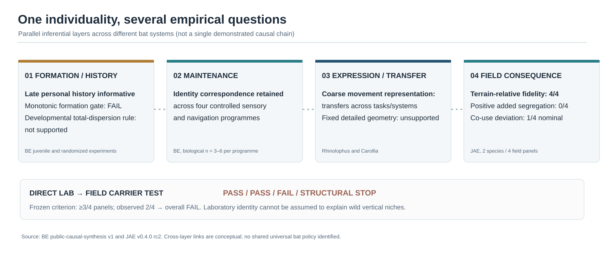
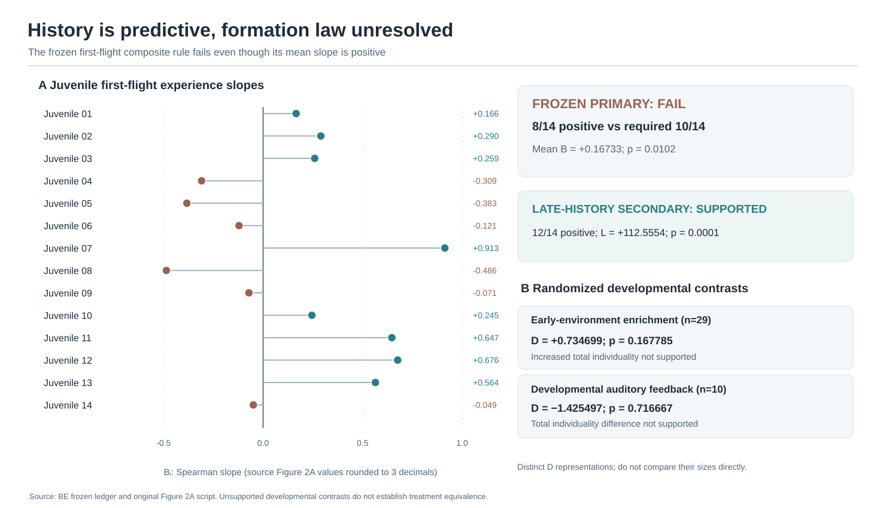
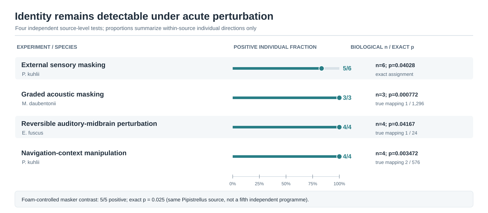
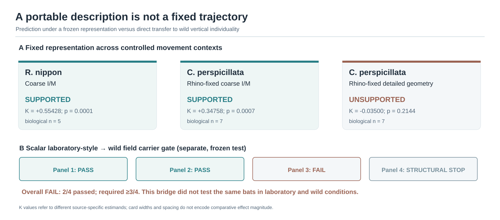
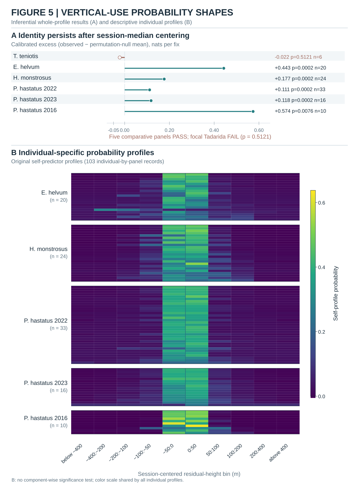
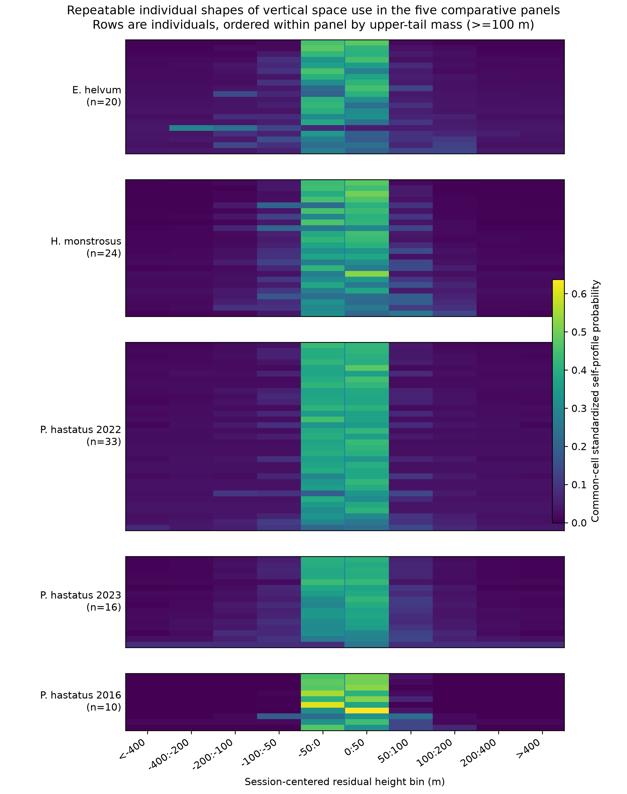
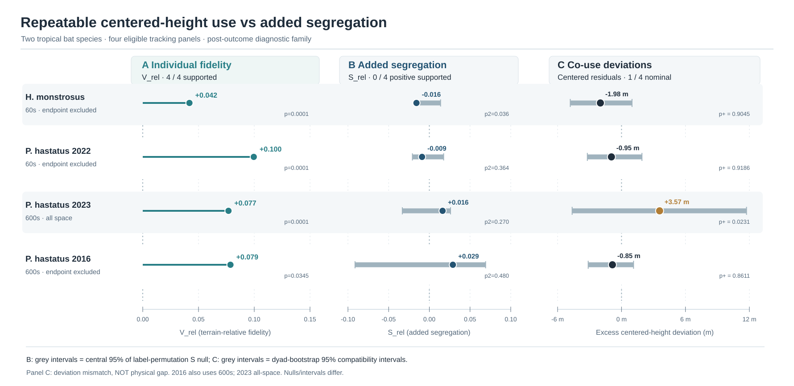
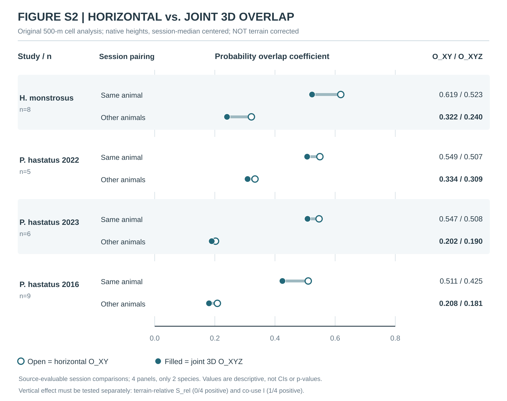

# Unified manuscript figures — rendered SVG atlas and scientific captions v1

**Created:** 2026-10-14  
**Status:** Figures have been generated and committed. They visualize previously frozen source summaries; they are **not** new result calculations. Figure content and axis semantics require independent human visual QA before submission.

All six SVGs are built from the exact source-derived summary snapshot in [figures/FROZEN_FIGURE_DATA_V1.json](figures/FROZEN_FIGURE_DATA_V1.json), via a zero-dependency Node script [figures/generate_integrated_figures_v1.cjs](figures/generate_integrated_figures_v1.cjs). The snapshot records the original JAE rc2 and BE v1 branch, path and file blob SHAs.

## Figure 1. Four empirically distinct questions about individuality

The diagram organizes independently measured questions about emergence/history, persistence under acute manipulation, cross-task representation and wild ecological outcome. Its co-use 1/4 entry denotes an **original nominal source-level residual-height-deviation difference**, not demonstrated physical altitude separation or competition. Dashed connectors are **conceptual**, not causal identification. Acute perturbation experiments retain source-specific correct-individual correspondence; coarse representations transfer more broadly than fixed detailed geometry; wild terrain-relative identity persists across four eligible panels even though positive added segregation is unsupported throughout. The frozen scalar laboratory-style carrier-to-field bridge fails its overall threshold, with two passes, one failure and one structural stop; these four bridge cells are not the same four tests as the wild terrain-relative geometry panels.

## Figure 2. Juvenile history and randomized developmental contrasts

Panel A shows the 14 juvenile first-flight individual Spearman slopes as encoded to three decimal places in the frozen BE figure-generation script. Only eight are positive, below the predeclared minimum ten. The mean slope is positive and its permutation p = 0.0102, but the **predeclared composite formation primary fails**. A predeclared later-history secondary (12/14 positive; L = +112.5554; p = 0.0001) does not rescue it. Panel B shows two separate randomized treatment contrasts in total multivariate individualization: Rachum enrichment (n = 29, D = +0.734699; p = 0.167785) and Elie auditory feedback (n = 10, D = -1.425497; two-sided p = 0.716667). Their D values use distinct measurements/scales and therefore are not plotted on a common quantitative axis. Lack of support is not an equivalence finding. Source studies document phenotype effects; source-specific feature decompositions remain descriptive.

## Figure 3. Identity correspondence persists under acute perturbation

Four independent current-context experimental programmes retain individual correspondence after perturbation: *Pipistrellus kuhlii* external masker (5/6 bats, p = 0.04028); *Myotis daubentonii* graded acoustic noise (3/3, true mapping rank 1/1296); *Eptesicus fuscus* reversible auditory-midbrain perturbation (4/4, rank 1/24); and *P. kuhlii* manipulated navigation conditions (4/4, rank 2/576). Marker position encodes only the within-study proportion of positive individual directions. Exact mapping nulls are distinct, and none of the plotted p values estimates species-level prevalence. The additional foam-controlled masker result (5/5; p = 0.025) is from the same source and is not a fifth independent system.

## Figure 4. Coarse portability, detailed realization and wild transfer

The fixed coarse I/M representation retains *Rhinolophus nippon* cross-task identity (n = 5, K = +0.55428; p = 0.0001) and transfers to independent *Carollia perspicillata* data (n = 7, K = +0.34758; p = 0.0007), while fixed detailed scale-free Rhino geometry does not pass that Carollia test (K = -0.0350; p = 0.2144). Card areas encode no effect-size magnitude. The separate scalar FlightIntensity wild carrier programme has two panel passes, one failure and one structural stop; it fails the required 3/4 total. No universal cross-species neural or behavioral latent state has been identified.

## Figure 5. Calibrated centered-shape identity and individual profile heterogeneity

The single 177 × 238 mm composited plate (Figure 5A+B) redraws the original JAE full probability vectors from the checksum-verified archive; panel B is **descriptive only**.

A separately maintained Figure 5A-only source-summary SVG is available for reproducibility: [centered-shape identity SVG](figures/FIGURE_5_CENTERED_VERTICAL_IDENTITY_V1.svg).

Observed-minus-null-centered shape identity is shown in nats per fix under each original panel's own whole-session permutation expectation. After common-cell horizontal weighting and session-median centering, the five non-*Tadarida* comparative panels meet their frozen shape-identity criterion; the motivating *Tadarida teniotis* panel does not (calibrated excess -0.022; p = 0.5121). The plotted quantities are neither absolute metres nor a claim about one specific vertical-distribution component. This SVG is **Figure 5A**, retaining the calibrated original whole-profile identity inference. **Figure 5B** below is the **actual original JAE PNG** restored from the archived run 36375056204, not generated from panel-level summaries. It displays 103 individual probability profiles across the five comparative panels, with ten predeclared height bins. Differences in central mass and upper/lower tails are descriptive only, are subject to finite-session estimation noise, and do not identify the individually calibrated carrier of the whole-profile test. The source CSV, JSON and checksum receipt are [archived alongside the manuscript](ORIGINAL_PROFILE_RECOVERY_RECEIPT_V1.md).

*Figure 5B source: frozen original JAE Figure 6; individual records n = 20/24/33/16/10 for Eidolon/Hypsignathus/Phyllostomus 2022/2023/2016. Tadarida is not included because its centered-shape criterion did not pass.*

## Figure 6. Centered terrain-relative fidelity, estimated segregation and co-use deviations

Four structurally eligible field panels from exactly two species (*Hypsignathus monstrosus*, and *Phyllostomus hastatus* in three datasets) are shown in a shared row order. **Rows denote shared original study-year panels with verified partial bat-ID overlap, not identical cohorts or paired outcomes.** In H/P2022/P2023/P2016 order, 500-m geometry V/S used **n=8/5/6/9**, co-use I used **n=11/6/6/5**, and fine 500-m place×speed-turning identity used **n=19/23/11/9**. Original 16 source-artifact ZIP SHA256 verifications and exact cohort-qualified ID comparisons show **V/S∩I = 5/3/5/5** and that every V/S bat appears in the fine 500-m set. Figure 6 now labels source V/S n, I n **and their shared bat-ID count** on each row. These membership intersections do not constitute a fitted within-bat fidelity-versus-encounter effect (Supplementary Table S15). **A** shows observed terrain-relative individual fidelity V_rel (4/4 positive and source-permutation supported). **B** shows observed added terrain-relative segregation S_rel (0/4 supported for a positive effect), together with the central 95% interval of the S label-permutation null; the *H. monstrosus* statistic lies in the **nominal negative** direction (original two-sided p = 0.0362, within-endpoint four-panel Holm p = 0.1448), not a supported positive segregation result. **A and B are different but algebraically linked source overlap estimators**, not independent biological replications: original native S = V − (mean epsilon_other − mean epsilon_self), where epsilon is the nonnegative difference between normalized joint XYZ overlap and conditional height overlap (see [exact coupling audit](V_S_ALGEBRAIC_COUPLING_AND_INDEPENDENCE_AUDIT_V1.md)). **C** shows a source-defined difference in **session-centered terrain-relative height deviations** for x-y-time-matched animals (three panels unsupported; *P. hastatus* 2023 +3.5737 m on the *centered-deviation scale*, nominal original upper-tail p = 0.0231, four-panel Holm p = 0.0924), together with 95% dyad-bootstrap **compatibility** intervals. Because each bat's own session median is subtracted before forming the absolute difference, **panel C does not estimate the actual physical vertical distance between two bats**, and the time-shift null assesses residual-deviation alignment rather than vertical avoidance. Intervals in panels B and C have **different definitions**, and panel C intervals are not formal equivalence tests.

Co-use source designs were: *H. monstrosus* = 60 s, endpoint excluded, 22 dyads; *P. hastatus* 2022 = 60 s, endpoint excluded, 10 dyads; 2023 = 600 s, all space, 8 dyads; 2016 = 600 s, endpoint excluded, 8 dyads. Hence 2023 is not simply the only 600-s panel: the unusual **all-space** scope also matters. The full terrain/co-use family is **post-outcome diagnostic**, so the figure does not claim that four prospective mechanism tests were preregistered as a single experiment. The co-use 600-second all-space panel is not instantaneous physical co-presence, and the source use of separately median-centered residual heights prevents direct altitude-gap inference. See [corrected co-use estimand audit](COUSE_CENTERING_PHYSICAL_GAP_SCOPE_AUDIT_V1.md). Under the **separate within-endpoint Holm arithmetic**, all four V_rel results remain below p = 0.05 (maximum adjusted p = 0.03453), but no S_rel or I result does. In a separately defined, retrospective **twelve-test** family pooling all V_rel/S_rel/I field tests, **three** V_rel results remain below 0.05 (H, P2022 and P2023, adjusted p = 0.0012); P2016 V_rel becomes p = 0.27622, and neither S_rel nor co-use I passes. These two family choices are sensitivity demonstrations, not fully predeclared or comprehensive multiplicity control. Original per-panel figure marks remain source-nominal results, not recalculated significance glyphs. See [four-panel](FOUR_PANEL_MULTIPLICITY_SENSITIVITY_V1.md) and [twelve-test](TWELVE_TEST_MULTIPLICITY_SENSITIVITY_V1.md) audits.

## Figure handling and evidence tiers

- The result graphics use reviewed full source-summary values, not simulated animals or a synthetic null distribution.
- The n values in Figs. 2–5 are biological individual counts in each original programme. The four field rows in Fig. 6 are not four taxonomically independent species.
- No pooling of incompatible K, A, B, D, V or S effect sizes is performed.
- Inference relies on the original source-specific tests and nulls. Figure formatting is not a fresh test or new external validation.
- View the SVG in GitHub, Illustrator, Inkscape or a compatible vector viewer; do a final readable-size and grayscale visual check in the journal's output size.
- Do not send this draft manuscript alongside independently submitted BE/JAE papers with duplicated core results; one publication plan is required.

## Supplementary Figure S1. Same-cohort overlap of original centered vertical-use shape

The source for this purely **post-outcome descriptive** plot is the unchanged 103 individual-by-panel profile JAE original Figure 5B self-predictor JSON, preserved under its original SHA256. For each original data panel, we compared **every unordered pair of different animals only inside the same collection cohort/site/colony/year**, not across geographically or temporally distinct cohorts. The centered 1D vertical-shape overlap coefficient O is the sum of each 10-bin pair's minimum probability, equivalent to one minus total variation distance. The **revised Figure S1 shows all 12 original collection cohorts separately**: eleven contain at least two original source-panel individuals and have descriptive median points; one *Eidolon* cohort contains one individual and is explicitly labelled **no pair**. Each row prints the biological profile-record count and the number of dependent within-cohort dyads; 10th–90th percentile bars appear only where at least three pair scores exist, while hollow marks indicate one-pair cohorts. The five pair-pooled panel medians (from 41/276/262/60/45 dependent dyads) remain in Supplementary Table S8. Source biological individuals per panel are 20/24/33/16/10, **not** the numbers of highly dependent dyads.

**Cohort weighting:** The original Figure S1 *v1* plotted dependent-dyad-pooled panel medians; the **v2 display was revised after inspecting cohort-weight imbalance** to plot actual cohort-specific median profiles directly. No biological outcome, criterion, or source pair value was recomputed or promoted to inference. Table S8 retains the dependent-pair-pooled medians, not species parameters. The Zambian 2014 *Eidolon* cohort alone contributes 28 of 41 pairs (68.3%); Aj-cave 2023 contributes 45 of 60 *P. hastatus* 2023 pairs (75.0%). Corresponding equal-cohort descriptive median-of-medians are 0.855 and 0.865, respectively; the former assigns equal display weight to *Eidolon* cohorts with as few as **a single pair**. See the 12-stratum table and noninferential sensitivity calculations in Supplementary Table S9 and Methods S14 ([audited values](figures/COHORT_WEIGHT_SENSITIVITY_V1.json)). These are not species-level inference or evidence of actual 3D overlap.

**These are NOT confidence intervals, p-values, equivalence margins, a new biological finding of true shared habitat or a full 3D niche overlap measure.** In the 2016/2022 La Gruta source population, Calderón-Capote et al. (2025; DOI 10.1371/journal.pone.0313782) had independently reported only about **0.20 horizontal foraging-area overlap** with a Bhattacharyya coefficient; this is **not directly comparable** to the 0.80–0.92 relative-height shape coefficient, and the latter must not be labelled 80–92% shared space. The original personal self-predictor profiles may be based on different horizontal cell supports/weights; each profile's height axis was independently median-centered and smoothed, making substantial 1D shape similarity partly a consequence of preprocessing. The plot does **not** compare exact co-occurring individuals or imply shared resources. Supported held-out shape identity (Figure 5A), source-calibrated added 3D segregation (Figure 6B) and original session phase-shift co-use separation (Figure 6C) remain three distinct analyses. This supplementary plot only exposes how estimated one-dimensional vertical profile shapes can be broadly similar while still supporting non-exchangeable personal held-out predictions in a different original inferential test.

Frozen descriptive method contract: [DESCRIPTIVE_VERTICAL_PROFILE_OVERLAP_CONTRACT_V1.md](DESCRIPTIVE_VERTICAL_PROFILE_OVERLAP_CONTRACT_V1.md). Reproducibility: [summary JSON](figures/FROZEN_PROFILE_OVERLAP_DESCRIPTIVE_V1.json), [all 684 unordered same-cohort pairs as CSV](figures/ORIGINAL_PROFILE_WITHIN_COHORT_OVERLAP_PAIRS_V1.csv), and [zero-dependency source/pair verifier](figures/derive_centered_vertical_overlap_v1.cjs) plus the [cohort-resolved v2 SVG renderer](figures/render_cohort_resolved_s1_v2.cjs). The figure is proposed **only for Supporting Information**; no seventh independent hypothesis or main-manuscript figure is created.

## Supplementary Figure S2. Original native-height horizontal and 3D joint probability overlap

This source-recovered, 177-mm-wide vector plot uses **only** the exact original historical 500-m native-height three-dimensional geometry result (successful workflow 36881187913). Each of the four originally eligible panels—*H. monstrosus* n=8 and three *P. hastatus* years n=5/6/9—displays the originally computed equal-individual means for repeated same-individual session pairs and for originally admitted different-individual session pairs. Open circles indicate horizontal probability overlap **O_XY**, filled circles indicate **α=0.5-smoothed** joint 500-m horizontal-cell × session-centered native-height-bin overlap **O_XYZ**. The original estimator adds a 0.5 pseudocount to every one of ten altitude bins in *each occupied horizontal cell*; at least 50 fixes per session are required across a pair's shared cells **in total**, not within every individual cell. The joining segment is therefore a descriptive model-dependent change on adding height, **not** directly observed 3D grid-cell co-use, independent dyad estimates, error bars, confidence intervals or synchronous co-presence measures.

For different-individual comparisons, the original **smoothed estimated** O_XY/O_XYZ values were **0.322/0.240**, **0.334/0.309**, **0.202/0.190**, **0.208/0.181**, respectively. Those O_XYZ values are **not observed percentages of airspace physically shared**; positive pseudocount regularization can yield joint modeled overlap even with no observed matched XY×height bin in a supported pair. The retrospective source-only mathematical demonstration and untested empirical smoothing sensitivity are recorded in [the estimator audit](SMOOTHED_3D_OVERLAP_SUPPORT_AUDIT_V1.md). The native normalized fraction of horizontal overlap lost on adding height, **R_3D = 1 - O_XYZ/O_XY for each original pair**, was averaged before reporting: do **not** compute its source mean as one minus the ratio of displayed column averages. The original native S_native (= other minus same mean R_3D) was +0.103, −0.017, −0.004, +0.130; importantly, **terrain-relative S_rel was later −0.0158, −0.0090, +0.0163, +0.0289, with zero of four positive permutation-supported results**. The positive source conditional vertical-fidelity result remains a different statistic based on O_Z|XY. These additional source results were originally post-outcome investigations and are not new corroborating field replicates.

**Distinguish from Figure S1:** S1 shows one-dimensional, session-median-centered *shape* intersection for 103 individual-by-panel source profiles (101 distinct literal source ID strings), 684 dependent dyads and different source-specific horizontal weights. S2 uses gridded **joint 3D** distributions of repeated eligible sessions, based on **only 8/5/6/9 biological animals** in four panels (two species). The O coefficients are not identical estimands, do not use the same subjects or spatial support and **cannot be subtracted as if they were paired heights and 3D distributions of the same animal groups**. Neither figure demonstrates diet overlap, resource sharing, instantaneous competitor avoidance or zero partitioning.

[Original native results JSON](figures/ORIGINAL_NATIVE_3D_OVERLAP_SUMMARY_V1.json) · [Deterministic S2 renderer](figures/render_original_native_3d_overlap_s2_v1.cjs) · [historical source and dependency recovery](NATIVE_3D_GEOMETRY_AND_SOURCE_CLOSURE_AUDIT_V1.md). Main original Figure 6 (terrain-relative fidelity, S_rel, and co-use) remains the authoritative figure for inferential status; S2 is a **historical descriptive source decomposition**. A matched original source re-expression in [Supplementary Table S13](SUPPORTING_INFORMATION_ANONYMOUS_DRAFT_V1.md) shows that the largest positive native S estimates decline after DEM subtraction (*H. monstrosus* +0.1029→−0.0158, *P. hastatus* 2016 +0.1304→+0.0289), but panel-wise V and S changes are not uniformly negative. The source GPS fields mix ellipsoid and mean-sea-level height references, and DEM subtraction is a proxy rather than observed physical AGL; these differences are descriptive and are **not** tests of topographic causation.
