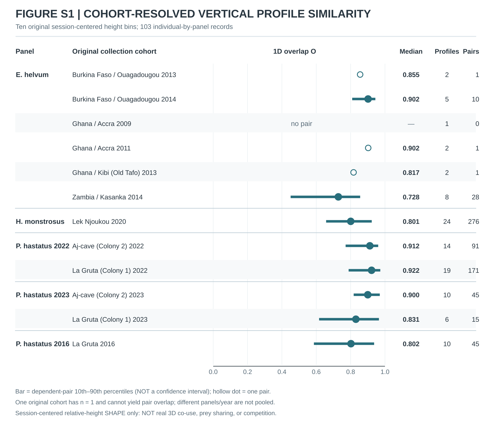

# Supplementary Material — anonymous review draft

**Associated manuscript:** Persistent individuality need not entail spatial partitioning in bats (anonymous draft).

**Contents:** experimental source metadata and frozen source-specific nulls, original six-panel wild vertical identity, terrain-relative fidelity and segregation tests, contemporaneous co-use uncertainty, external boundary cases, and evidence-tier rules.

**Review status:** source tables and estimands are retained; anonymous computational archive URL and author approvals are pending. This file is not the final submission version.

## Study scope and source-provenance principles

The study reanalyzes publicly archived bat experiments and independent repeated field tracking datasets. The individual bat is the biological replication unit; trial, call, GPS fix, session, dyad and permutation counts are not substitutes for independent biological individuals. Study-specific statistical endpoints and exchangeability nulls were recorded before their corresponding result values were opened, whereas the across-source synthesis was iteratively developed and not preregistered as a prospective multisystem meta-analysis. Field terrain-relative and co-use analyses were explicitly **post-outcome diagnostics**.

The detailed reproducibility contracts and legally redistributable data-derived tables will be linked from the anonymized source archive when placed: [ANONYMIZED_REVIEW_ARCHIVE_URL]. Original source data are cited under their public source DOIs.

## Supplementary Table S1. Experimental public sources and provenance

| Source | Species | Public archive | Programme role | Biological n | Source-level status |
|---|---|---|---|---:|---|
| Harten et al. 2020 | Rousettus aegyptiacus | Mendeley 10.17632/n9d8gbz3xr.1 | first-flight history formation/maintenance | 14 | primary formation FAIL; late secondary supported |
| Rachum et al. 2025 | Rousettus aegyptiacus | Mendeley 10.17632/wh7c636y3t.1 | randomized enrichment / individualization | 29 | unsupported individualization |
| Elie et al. 2024 | Rousettus aegyptiacus | Mendeley 10.17632/h5ff9vv5pc.1 | randomized auditory-feedback development | 10 | no difference in total individualization |
| Taub & Yovel 2020 | Pipistrellus kuhlii | source public archive / source paper | external sensory masker | 6 | supported |
| Foskolos et al. 2022 | Myotis daubentonii | Zenodo 10.5281/zenodo.4946256; Dryad 10.5061/dryad.ngf1vhhv3 | graded masking | 3 complete | supported; small n |
| Diebold et al. 2024 | Eptesicus fuscus | Zenodo 10.5281/zenodo.13857870 | reversible auditory-midbrain perturbation | 4 | supported; small n |
| Aharon et al. 2017 | Pipistrellus kuhlii | Mendeley 10.17632/f6mvhj5gj9.3 | navigation-context manipulation | 4 | supported |
| Teshima et al. 2026 | Rhinolophus nippon | source public archive | coarse policy portability | 5 adult mechanism cohort | supported; small n |
| Eveland et al. 2026 | Carollia perspicillata | public repository 00keveland/Tunnel_2026 | external fixed-representation transfer | fixed evaluable cohort | coarse supported; detailed geometry unsupported |
| frozen wild carrier programme | multiple wild bat panels | source Movebank datasets | laboratory-to-wild boundary | 4 panels | 2/4 FAIL |

---

## Supplementary Table S2. Experimental endpoint definitions, biological support and frozen nulls

| Source / analysis | Biological unit | Frozen endpoint / representation | Scale / shared-context removal | Biological support | Frozen null | Primary rule / status |
|---|---|---|---|---|---|---|
| Harten first-flight primary | juvenile bat | individual Spearman slope (B_i) of own-history predictive advantage vs prior valid-day count | source-coordinate spatial-history score; equal individual weighting | 14 juveniles, target valid-day ordinals 3–20 | 9,999 whole-history identity permutations within cohort | programme excess >0, p<=0.05, >=70% positive slopes; **FAIL** because 8/14 positive |
| Harten late-history secondary | juvenile bat | mean late own-history advantage (L_i), target ordinals 11–20 | same frozen source-coordinate estimator | same 14 juveniles | same frozen permutation architecture | predeclared secondary; L=+112.5554, p=0.0001, 12/14 positive |
| Harten recent-vs-earliest diagnostic | juvenile bat | (Q): recent two-day history advantage minus earliest two-day history advantage | equal-sized two-day history windows | same 14 juveniles | post-primary diagnostic permutation | **diagnostic only**; cannot rescue failed primary |
| Rachum laboratory individualization | bat | 3-D change vector: Boldness, Exploration, Activity | traits standardized from pooled Trials 1–2 only; treatment-group mean change removed | Season-2 complete n=29, 14 enriched / 15 impoverished | 199,999 origin-stratified random assignments, seed 202610070817 | D=V_enriched-V_impoverished >0 and p<=0.05; **unsupported**, p=0.167785 |
| Elie developmental auditory feedback | bat | 28-D whole-repertoire adult vocal centroid | treatment-blind feature scaling; sex×treatment centroid removed | 10 randomized bats, 5 hearing / 5 deafened; >=1,037 finite calls per bat×feature | exact 120 sex-conditioned assignments | two-sided treatment contrast in total residual dispersion; **no difference in amount**, p=0.716667 |
| Taub & Yovel masker | bat | source-native approach/movement angle personal-bias state | condition-centered personal bias | 6 bats baseline→masker; independent foam contrast 5 bats | exact complete identity permutations: 6!=720 and 5!=120 | K>0 with exact upper-tail support; both contrasts **supported** |
| Foskolos graded masking | bat | log flight-time identity state across five noise levels | shared condition mean removed | 3 bats complete across all 5 levels | exact 1,296 legal condition-wise identity assignments | positive programme identity advantage + exact support; **supported, small n** |
| Diebold auditory-midbrain perturbation | bat | 4-D trial vocal vector: duration, bandwidth, IPI, call rate | treatment×trialtype pooled mean removed without identity; pooled residual SD | 4 DREADD bats with >=5 saline and >=5 ligand trials | exact 4!=24 saline/ligand identity mappings | K>0, p<=0.05; **supported**, true mapping rank 1/24 |
| Aharon navigation-context manipulation | bat | bilateral turning-location vector from per-trial left/right medians | source-condition mean removed across 4 bats | 4 bats × 3 source conditions; >=10 valid trials/cell | con anchored; labels independently permuted in 75 and 300: (4!)²=576 | K>0, p<=0.05; **supported**, rank 2/576 |
| Teshima/Rhino transparent policy | bat | fixed (I,M) from eight 3-D trajectory features | feature z-scoring within obstacle environment | 5 adult *Rhinolophus nippon* | 9,999 environment-wise identity permutations, frozen seed | K>0, p<=0.05, positive individual fraction gate; **supported**, 5/5 positive |
| Eveland/Carollia fixed I/M | bat | Rhino-fixed (I,M) representation | feature standardization within fixed date block | 7 evaluable bats across two date blocks | 9,999 trial-label shuffles within date block, seed 202610051141 | K>0, p<=0.05, >=70% positive bats, both block means >0; **supported** |
| Eveland/Carollia detailed geometry | bat | fixed scale-free Rhino trajectory-geometry representation | same fixed date-block architecture | same 7-bat external cohort | 9,999 fixed-architecture permutations | **unsupported**, K=-0.0350, p=0.2144 |
| Wild scalar carrier bridge | panel | frozen scalar FlightIntensity persistence | source-panel-specific frozen estimator | 4 wild panels | panel-level frozen PASS/FAIL gates | bridge opens only if >=3/4 panels support; observed 2/4 -> **FAILED FROZEN GATE** |
| Wild H/V localization | selected wild panel | post-outcome H/V components | harmonized/post-outcome representation | selected contexts only | post-outcome diagnostics | **exploratory only**; cannot reopen scalar bridge |

## Supplementary Table S3. Wild original panel archive register

| Original panel | Movebank archive DOI | Integrated role |
|---|---|---|
| *Tadarida teniotis* | 10.5441/001/1.52nn82r9 | Motivating boundary; centering fails |
| *Eidolon helvum* | 10.5441/001/1.k8n02jn8 | Comparative centered-shape PASS |
| *Hypsignathus monstrosus* | 10.5441/001/1.278 | Centered shape and terrain/co-use eligible |
| *Phyllostomus hastatus 2022* | 10.5441/001/1.321 | Centered shape and terrain/co-use eligible |
| *Phyllostomus hastatus 2023* | 10.5441/001/1.322 | Centered shape and terrain/co-use eligible |
| *Phyllostomus hastatus 2016* | 10.5441/001/1.282 | Centered shape and terrain/co-use eligible |

The underlying **source-study attribution** is also specific: *Tadarida teniotis*—O'Mara et al. (2021); *Eidolon helvum*—O'Mara et al. (2019), **not** the earlier Fahr et al. (2015) movement paper; *Hypsignathus monstrosus*—Schloesing et al. (2023); the 2016 *Phyllostomus hastatus* archive—O'Mara and Dechmann (2023); and the longitudinal 2021–2023 *P. hastatus* archives—Calderón-Capote et al. (2024). These citations specify where the public tracking records came from, not demonstrated causation of the reanalysed individual vertical-use patterns.

The panel-specific DOIs are mapped by **study year**, not by the unordered group of three source DOIs: the 2016 archive is 10.5441/001/1.282, the 2021–2022 archive (2022 analysis panel) is 10.5441/001/1.321, and the 2023 archive is 10.5441/001/1.322. This mapping follows the original frozen data-ingestion script and original tracking Methods; it is distinct from a mere enumeration of source DOIs. The original tracking source screen considered 23 Movebank parent datasets, admitted six same-event x-y-height repeated-tracking panels and then closed its source universe. The 2016 *P. hastatus* panel has weaker overlap of individual tracking windows (31.1%) than the five others, so identity/time confounding has a stronger residual limitation. The motivating *T. teniotis* panel is not a positive example of session-centered shape identity. All wild panel-level inclusion, source checksums and height-datum processing remain available in the original tracking source receipts and manuscript Methods.

## Supplementary Table S4. Session-centered vertical identity (original calibrated results)

| Panel | Biological n | Observed | Null mean | Calibrated excess (nats/fix) | Permutation p | Original verdict |
|---|---:|---:|---:|---:|---:|---|
| T. teniotis | 6 | -0.2629 | -0.2408 | -0.0222 | 0.5121 | FAIL |
| E. helvum | 20 | 0.3719 | -0.0710 | 0.4429 | 0.0002 | PASS |
| H. monstrosus | 24 | 0.0736 | -0.1032 | 0.1768 | 0.0002 | PASS |
| P. hastatus 2022 | 33 | -0.0394 | -0.1508 | 0.1114 | 0.0002 | PASS |
| P. hastatus 2023 | 16 | 0.0454 | -0.0726 | 0.1181 | 0.0002 | PASS |
| P. hastatus 2016 | 10 | -0.0084 | -0.5824 | 0.5740 | 0.0076 | PASS |

These are full-pipeline whole-session individual-label permutation nulls, not a test against a naive zero baseline. Each evaluated session was shifted to its own zero median before fixed vertical binning. Centering removes an additive constant altitude offset; it does not remove non-additive device error. The original tracking full individual-profile heatmap (103 individual-by-panel profiles across five comparative panels) has now been **restored unchanged** from archived workflow artifact 10950667566 as [Figure 5B](figures/original_jae/figure6_individual_centered_shape_profiles.png); its exact source CSV and JSON are alongside the image, with original hashes and reconstruction details in the source-profile archive receipt. This figure is descriptive only: observed component ranges and heatmap heterogeneity are not separately exchangeability-calibrated; finite-session estimation noise and state-dependent altitude error remain possible.

## Supplementary Table S5. Terrain-relative individual fidelity and added segregation

| Field panel | Observed V_rel | V upper-tail p | Observed S_rel | S null mean | S null 2.5% | S null 97.5% | S two-sided p |
|---|---:|---:|---:|---:|---:|---:|---:|
| H. monstrosus | 0.04186 | 0.0001 | -0.01581 | 0.00008 | -0.01567 | 0.01380 | 0.0362 |
| P. hastatus 2022 | 0.09956 | 0.0001 | -0.00896 | -0.00037 | -0.02081 | 0.01755 | 0.3639 |
| P. hastatus 2023 | 0.07689 | 0.0001 | 0.01626 | 0.00069 | -0.03320 | 0.02602 | 0.2704 |
| P. hastatus 2016 | 0.07865 | 0.0345 | 0.02890 | 0.00018 | -0.09129 | 0.06912 | 0.4796 |

All four panels comprise *H. monstrosus* and three *P. hastatus* datasets (two species, not four). The terrain-relative geometry family was developed **post-outcome**. Positive V_rel fidelity was supported in all four. No S_rel panel supported the **positive added-segregation** direction; *H. monstrosus* showed a negative-side signal (two-sided p = 0.0362). The S null quantiles are permutation-null intervals and **not** confidence intervals for observed S. A positive uncalibrated S value alone is insufficient to support segregation.

## Supplementary Table S6. Synchronous co-use design, excess and compatibility uncertainty

| Field panel | Time window | Spatial scope | Biological n | Dyads | Encounters | Excess above phase-shift null (m) | upper-tail p | Dyad-bootstrap 95% compatibility range (m) | Positive direction supported? |
|---|---:|---|---:|---:|---:|---:|---:|---|---|
| H. monstrosus | 60 s | endpoint-excluded | 11 | 22 | 883 | -1.983 | 0.9045 | [-4.808, 0.985] | NO |
| P. hastatus 2022 | 60 s | endpoint-excluded | 6 | 10 | 347 | -0.947 | 0.9186 | [-3.207, 1.918] | NO |
| P. hastatus 2023 | 600 s | all-space | 6 | 8 | 679 | 3.574 | 0.0231 | [-4.633, 11.729] | YES |
| P. hastatus 2016 | 600 s | endpoint-excluded | 5 | 8 | 16096 | -0.854 | 0.8611 | [-3.127, 1.128] | NO |

The fixed co-use primary scores median terrain-relative vertical differences within each dyad then averages dyads equally. The source-specific phase-shift procedure breaks contemporaneous cross-animal height alignment at frozen actual encounters. The *P. hastatus* 2023 encounter set is **all-space with a 600-second window** because the endpoint-excluded universe did not meet its biological-individual gate; 2016 also used 600 seconds but endpoint exclusion. The 2023 positive result (+3.574 m, phase-shift upper-tail p = 0.0231) had eight dyads and a wide dyad-resampling interval crossing zero; neither this interval nor those in the other three panels are formal equivalence tests or power calculations.

## Supplementary Table S7. External wild centered-shape boundary tests

| Source | Calibrated excess | Original frozen p | n | Status / limitation |
|---|---:|---:|---:|---|
| *Nyctalus noctula* (first primary) | +0.05175 | 0.1224 | 27 | FAIL; later same-source revised eligibility is not the authoritative primary |
| *Hipposideros armiger/pratti* | −0.04468 | 0.8616 | 13 | FAIL |
| *Myotis vivesi* | +0.00470 | 0.4419 | 4 | FAIL in a separate four-individual programme |
| *Pteropus poliocephalus* | +0.16873 | 0.0001 | 4 | PASS in separate four-individual programme; after DEM subtraction +0.03231, p=0.0023 |

External results are scope/boundary probes, not a statistically sampled estimate of bat-wide prevalence. The original tracking V1/V2 *Tadarida* residual cell × height map did not support a stable individual-specific residual route map (p=0.160), even though its more basic absolute-height identity score was positive.

## Supplementary Table S8. Exploratory, cohort-restricted overlap of original individual relative-height probability shapes

This **post-outcome descriptive** calculation uses the same 103 original Figure 5B individual-by-panel leave-one-session-out self-prediction profiles and exactly their original ten session-median-centered altitude bins. It was not a primary endpoint, adds no hypothesis test and is not the source S_rel measure of 3D segregation. Only unordered pairs of different animals within the exact original study panel **and** collection cohort (site/colony/year) are allowed; different geographic sites, years or colonies are never directly compared.

| Original panel | Biological individuals | Source cohorts | Eligible within-cohort pairs* | Overlap 10th percentile | Overlap median | Overlap 90th percentile |
|---|---:|---:|---:|---:|---:|---:|
| *Eidolon helvum* | 20 | 6 | 41 | 0.512 | **0.817** | 0.918 |
| *Hypsignathus monstrosus* | 24 | 1 | 276 | 0.657 | **0.801** | 0.923 |
| *Phyllostomus hastatus* 2022 | 33 | 2 | 262 | 0.772 | **0.919** | 0.967 |
| *P. hastatus* 2023 | 16 | 2 | 60 | 0.787 | **0.899** | 0.970 |
| *P. hastatus* 2016 | 10 | 1 | 45 | 0.586 | **0.802** | 0.937 |

*The **684 pairs are highly dependent descriptions**, not 684 biological replicates, not confidence-interval sample sizes and not a new permutation test. The 10th/90th percentiles show the spread of observed dyad values, **not statistical uncertainty**. For *Eidolon*, six collection cohorts span countries/years; one has only one individual and therefore generates no pair. More dyads arise in larger cohorts, so the pooled within-panel median is not an equally weighted independent-cohort mean. The full cohort breakdown is retained in the reproducibility JSON.

**Figure S1.** Within-cohort overlap of the original session-centered, 10-bin probability **shapes**, plotting per-panel median and descriptive 10th–90th dyad percentiles on the [0,1] overlap axis (source vector `FIGURE_S1_WITHIN_COHORT_VERTICAL_SHAPE_OVERLAP_V1.svg`). A value close to one describes similar *estimated relative-height shape*, not co-use of the same flight volume or overlap of the same prey resources. This figure has no inferential uncertainty band and must not be substituted for the original Figure 6 S_rel / co-use tests.

### Supplementary Figure S1. Within-cohort relative-height shape overlap (post-outcome descriptive only)

## Supplementary Table S9. Cohort dependence of the exploratory vertical-profile overlap

The pair-pooled Figure S1 medians are **not estimates of species-wide niche overlap**. The original 103 panel-indexed profiles occur in source site/colony/year cohorts, with n(n−1)/2 different-individual pairs from a cohort containing n eligible profiles. Thus large cohorts dominate a pooled **dependent-dyad** median. This post-outcome audit summarizes the original **same-cohort 1D session-centered shape** values; there is no new hypothesis test, statistical uncertainty interval or biological animal-level replication.

| Original panel | Panel profile records | Dependent pairs | Pooled pair median O | Median of pair-eligible cohort medians | Largest cohort's fraction of pairs | Median after removing largest cohort |
|---|---:|---:|---:|---:|---:|---:|
| *E. helvum* | 20 | 41 | 0.817 | 0.855 | **68.3%** (28/41) | 0.887 (13 pairs) |
| *H. monstrosus* | 24 | 276 | 0.801 | 0.801 | 100% (276/276) | Not estimable: one cohort |
| *P. hastatus* 2022 | 33 | 262 | 0.919 | 0.917 | **65.3%** (171/262) | 0.912 (91 pairs) |
| *P. hastatus* 2023 | 16 | 60 | 0.899 | 0.865 | **75.0%** (45/60) | 0.831 (15 pairs) |
| *P. hastatus* 2016 | 10 | 45 | 0.802 | 0.802 | 100% (45/45) | Not estimable: one cohort |

The *median of eligible cohort medians* assigns equal weight to each cohort with at least one observed pair, but is **not confidence** in a species-level parameter. In *Eidolon*, three of the five pair-eligible cohorts contain just two panel-records and hence **a single pair each**. Equal cohort weighting can therefore overemphasize tiny groups. Removing the largest cohort is also only a descriptive recalculation, **not a robustness test with a valid confidence interval**, and is undefined for a single-cohort panel.

| Original panel | Exact source cohort | Source panel records | Nonindependent pairs | Cohort median O |
|---|---|---:|---:|---:|
| *E. helvum* | Burkina Faso, Ouagadougou::2013 | 2 | 1 | 0.855 |
| *E. helvum* | Burkina Faso, Ouagadougou::2014 | 5 | 10 | 0.902 |
| *E. helvum* | Ghana, Accra::2009 | 1 | 0 | Not defined |
| *E. helvum* | Ghana, Accra::2011 | 2 | 1 | 0.902 |
| *E. helvum* | Ghana, Kibi (Old Tafo)::2013 | 2 | 1 | 0.817 |
| *E. helvum* | Zambia, Kasanka::2014 | 8 | 28 | **0.728** |
| *H. monstrosus* | Lek Njoukou::2020 | 24 | 276 | 0.801 |
| *P. hastatus* 2022 | Aj-cave (Colony 2)::2022 | 14 | 91 | 0.912 |
| *P. hastatus* 2022 | La Gruta (Colony 1)::2022 | 19 | 171 | 0.922 |
| *P. hastatus* 2023 | Aj-cave (Colony 2)::2023 | 10 | 45 | 0.900 |
| *P. hastatus* 2023 | La Gruta (Colony 1)::2023 | 6 | 15 | **0.831** |
| *P. hastatus* 2016 | La Gruta::2016 | 10 | 45 | 0.802 |

The 2016 and 2022 archives reuse **two literal source identifiers**; whether they indicate recaptured bats is unresolved. They were not cross-compared in the present same-panel-and-cohort pair universe. These collections have different spatial supports, seasons and sampling opportunities; panel aggregation, colony median differences and cross-year changes are not formal tests of adaptive strategy differences or competition.

## Supplementary Methods S1. Boundaries of the three integrated inference axes

**Identity correspondence:** correct animal–behavior mapping after source-specific shared-condition adjustment. Each experimental study uses its own fixed representation, biological support and assignment null; raw K, A or B values cannot be combined into a single pooled metric.

**Developmental individualization:** origin-stratified or sex-conditioned assignment of randomized treatments and the corresponding effect on predeclared residual multivariate dispersion. Failure to reject a change in D does not prove that variance and covariance are identical under treatment, nor does it exclude trait-level changes. Elie feature contributions (15 positive, 13 negative) and Rachum trait contributions (all three positive) remain descriptive, not confirmatory reallocation tests.

**Field individuality vs partitioning:** the held-out centered-shape individual score, V_rel terrain-relative configuration fidelity, S_rel added-segregation test, and I synchronous co-use separation use different nulls. They quantify distinct ecological questions. Four/panel counts must not be interpreted as four independent species or four confirmations of a joint laboratory-to-field causal mechanism.

## Supplementary Methods S2. Evidence ranks and historical freeze amendments

1. A source-level primary must pass **all** frozen gates to be supported. The juvenile formation primary FAILS even though its mean permutation test p=0.0102, because only 8/14 slopes were positive against required 10/14.
2. The juvenile late-history result is a predeclared **secondary** that supports late personal-history prediction, but the early-vs-recent Q statistic is post-primary diagnostic.
3. Randomized developmental D contrasts are unsupported under their source-specific tests. **Absence of support is not statistical equivalence.**
4. A source-level structural STOP is not a biological FAIL (e.g. broad ERA5 wind reaction norm test stopped at 7 eligible *P. hastatus* 2023 individuals against eight required, before numeric vertical outcomes).
5. Field terrain/co-use and lag/kinematic stress tests are **post-outcome** diagnostic families, although their later specific null outputs were frozen before being inspected. Their inferential tier is not promoted retrospectively.
6. Frozen laboratory-style wild FlightIntensity scalar carrier: PASS/PASS/FAIL/STRUCTURAL STOP = 2/4, below ≥3/4 overall threshold. Later H/V field components are exploratory only and do not rescue the scalar field gate.
7. No universal neural policy, direct learned-route cause, specific fitness advantage, or competition absence has been identified.

## Supplementary Methods S3. Figure reproducibility and non-independence guard

Figs. 1–6 are reproducible vector summaries generated from the exact frozen source-summary snapshot and validated original individual-profile records. The combined Figure 5A/B plate is 177 × 238 mm; Figure 5B redraws the original 103 individual-by-panel profile records' ten-bin probability vectors without smoothing or re-estimation. The complete original PNG, CSV and JSON are preserved unchanged and hash verified; the original figure's profile contrasts are descriptive only and have no component-wise null calibration. The rendering workflow checks figure determinism, XML structure, archived-source checksums and evidence-tier outcomes. The figure packaging adds no inferential tests and does not alter the source result receipts.

## Supplementary Methods S4. Wild-panel source eligibility, observational units and vertical datums

The repeated-tracking programme began with an outcome-blind screen of 23 Movebank parent datasets and accepted six bat panels across four taxa. Eligibility was based on event-level presence of horizontal coordinates, a vertical measurement and a timestamp, plus identifiers and repeated-session structure; it was not based on vertical effect sizes. Structural admission required at least eight animals with simultaneous x-y-height presence and at least five animals with at least two sessions containing a minimum 50 qualifying fixes. Source data and processing receipts remain frozen in the original tracking programme. Original individual counts contributing to the final median-centered whole-distribution test were 6 Tadarida, 20 Eidolon, 24 Hypsignathus, and 33, 16 and 10 Phyllostomus individuals in the 2022, 2023 and 2016 datasets.

Sessions were identified at the level of source-defined repeated tracking bouts, respecting cohort and within-panel distinctions. *Tadarida teniotis* used animal identity by BatDay, horizontal EPSG:3035 coordinates and source-annotated MSL and above-ground coordinates. The originally annotated Tadarida table contained 9,873 observations after the source-workflow manual exclusions. *Eidolon helvum* used an ellipsoid-height field and cohort strata of study site by shifted-night year; *Hypsignathus monstrosus* used the Lek Njoukou 2020 context and an ellipsoid-height field. The three *Phyllostomus hastatus* studies must not be interchanged: the 2016 panel came from Movebank 10.5441/001/1.282, the 2021–2022 source from 10.5441/001/1.321, and 2023 from 10.5441/001/1.322. The first and 2016 datasets used MSL elevation, whereas 2023 used an ellipsoid-height source variable. Inference is therefore within each original panel and never based on absolute cross-taxon height comparisons.

GPS fixes estimated session conditional probabilities and predictive scores but were not independent animal replicates. Prediction used held-out target sessions; session scores were averaged within animals and animals contributed equally to programme-level summaries. The same biological individual could appear in multiple sessions, but these sessions were not counted as independent animals.

## Supplementary Methods S5. Common-cell predictive identity and whole-session exchangeability calibration

The original wild predictor compared each target session with (i) a self distribution constructed from other qualifying sessions of that animal and (ii) a different-individual predictor built from eligible peers in its frozen panel/cohort. Common-cell standardization restricted target predictions to horizontal cells supported by both estimators at the original 5-km grain. For each eligible self-training session, its relative cell frequency was computed over only these shared cells; averaging these frequency vectors equally across training sessions and renormalizing yielded one shared weight vector w(c).

The self marginal vertical profile was M_self(z) = sum over shared c of w(c) times P_self(z|c). The different-individual comparator M_other(z) used the **same** weights w(c) multiplying P_other(z|c). The held-out score G_cc = average over target fixes of log M_self(z) minus log M_other(z). This construction removes variation in occupancy among the tested common 5-km cells from the comparison; it does not eliminate horizontal fidelity **within** cells or demonstrate complete place matching.

The finite smoothing and training pipeline does not have a universal zero expectation. Whole-session individual-label permutations therefore recalculated the entire comparison under exchangeability while retaining each session's x-y-z tracks, session sizes, cohort membership and counts of sessions per assigned label. The original Tadarida calibration used 9,999 fixed-seed PCG64 label assignments, while the five original comparative panels used 4,999 panel-specific fixed-seed assignments under one calibration rule frozen before those nonfocal numerical outcomes were inspected. For each source, report observed G_cc, its full-pipeline permutation-null mean, the calibrated excess (observed minus null mean) and the upper-tail permutation probability P(null >= observed). A negative observed G_cc can still exceed a more negative finite-sample null mean; do not use an intuitive zero instead of the source-specific null.

The original 2022 *P. hastatus* apparent marginal-versus-conditional predictive architecture changed under common-cell reweighting; it was not retained as evidence for multiple universal architectures. Pairwise self-identification, endpoint-neighbourhood deletion and focal metre-scale translations use distinct estimator/null families and are not additional cross-species evidence for one scalar policy.

## Supplementary Methods S6. Centered-shape and additive device-offset controls

Because different GPS devices can have stable additive altitude offsets, each retained session was first translated so its median reported height equalled zero. Fixed centered residual-height bins were defined by boundaries at minus infinity, -400, -200, -100, -50, 0, +50, +100, +200, +400 and plus infinity metres. Jeffreys smoothing added 0.5 pseudo-count per vertical bin before normalized conditional probabilities were integrated under the original common horizontal weights.

The frozen centered-shape inference preserved the eligible session sets, source cohorts, scoring threshold and whole-session permutation family. Supported shape identity required a positive calibrated observed-minus-null advantage with upper-tail p <= 0.05 and the frozen evaluable-animal count. This removes any session-specific **constant** zero-point error but not state-dependent, heteroscedastic, tag-specific variance, flight-error dynamics, or all fine-scale spatial effects. Five comparative panels passed; the motivating Tadarida centered-shape primary failed (p = 0.5121).

A separate x-y/time-only preflight for stationary-height correction selected candidate stationary segments when both adjacent time gaps were no more than 20 minutes and both adjacent estimated speeds were no more than 0.5 m/s. Shared 100-m cells required at least three individuals with at least five stationary fixes each, while supported individuals required at least ten candidate fixes. Only the *H. monstrosus* and 2016 *P. hastatus* panels passed the predeclared eligible-individual and cohort gates. Individual-by-cohort stationary-height offsets were estimated relative to median shared-cell heights, removed from the original measurements, and the common-cell original-height calibration rerun; both remained predictive at p = 0.0002. This is corroboration only: shared stationary cells are not verified equal physical altitudes.

The original descriptive heatmap profiles are not new raw-fix histograms. For each evaluable target session, the exact leave-one-session-out self predictor was reconstructed from that animal's other sessions, restricted to jointly supported common cells and weighted under the same equal-self-session cell frequencies as its frozen inferential score. Target-session profiles were then averaged equally within the biological individual. The 103 archived individual probability vectors cover ten centered bins and sum to one within each row. Apparent upper-tail, lower-tail and central-concentration heterogeneity is **descriptive**: those components were not separately recalibrated against individual exchangeability, and finite-session profile-estimation noise contributes to the visible spread.

## Supplementary Methods S7. Local terrain fidelity, added segregation, synchronous co-use and compatibility bounds

The additional ecological geometry family was developed **after** the original centered-height outcomes were known; its inferential tier remains post-outcome even when later null recipes were fixed before their own outputs. Four original datasets from *H. monstrosus* and *P. hastatus* met structural 500-m-grain conditions. Local terrain elevation was bilinearly interpolated from a digital elevation model and subtracted from each event's source altitude before comparing individual and nonindividual vertical configurations within pairwise-shared horizontal cells. The original inherited label-permutation family (9,999 assignments per panel) calibrated terrain-relative identity V_rel and added segregation S_rel under a common source-specific null.

The added-segregation statistic was defined as different-individual 3D overlap distance minus same-individual 3D overlap distance. A positive observed S_rel alone does not imply a supported positive segregation effect: the source-specific permutation tail must be evaluated. All four V_rel panels passed, none supported a positive added S_rel; *H. monstrosus* instead had a two-sided p = 0.0362 in the negative direction. Negative added segregation does not by itself identify attraction, cooperation or competition.

A separate fixed local co-use programme selected actual events where distinct animals occupied the same 500-m horizontal cell within the narrowest admissible structural time window from 60, 120, 300 or 600 seconds. Source scope also required minimum numbers of identifiable bats/dyads. The frozen accepted encounter rules were H = 60 seconds with endpoint-neighbourhood exclusion (22 dyads), P2022 = 60 seconds with endpoint exclusion (10 dyads), P2023 = 600 seconds all-space (eight dyads), and P2016 = 600 seconds with endpoint exclusion (eight dyads). Importantly, 2023 is **not** the only 600-second panel; its all-space rather than endpoint-excluded definition also differs.

The primary co-use statistic was the absolute terrain-relative, session-centered height difference at fixed actual cross-individual encounters, summarized first by the median within each qualifying dyad then weighted equally among dyads. A circular phase shift of complete sessions preserved individual route, altitude distributions and observed co-use encounter set while breaking direct cross-individual vertical synchronization. Directional upper-tail inference tested whether observed panel dyad-averaged separation exceeded the phase-shift null mean. Only P2023 was positive (+3.5737 m, p = 0.0231), and its effect used the coarse all-space definition.

After this phase-shift analysis, 9,999 equal-dyad bootstrap resamples held the fixed null mean and estimated compatibility intervals for the panel's observed-minus-null excess. Nonpositive-test panels had positive 95% upper endpoints approximately +0.985, +1.918 and +1.128 m; the P2023 interval ranged -4.63 to +11.73 m. These **dyad-resampling compatibility intervals are not formal equivalence bounds or evidence of a zero effect**, and they must not be mistaken for the central 95% of the separate S_rel label-permutation null.

## Supplementary Methods S8. Post-outcome temporal and conditional-strategy stress tests

Persistence probes used the same already-established centered height estimator but rebuilt the self predictor with different permitted personal histories. The original temporal exclusions required self-training sessions at least one, three or seven days from each target, respectively. Each lag was subject to its own fixed x-y-time eligibility preflight and the original whole-session exchangeability calibration, so 4/4, 3/3 and 2/2 refer to structurally eligible panel counts at those particular lags rather than independent biological replications.

A fine-matching diagnostic conditioned comparisons jointly on 500-m location cells, a predeclared binary speed state and a binary turning state. All four eligible tropical bat panels preserved above-null identity under this control; the kinematic features are **proxies**, not externally verified commuting, foraging or social labels. Under a separate 2-km place by kinematic and contemporaneous-conspecific comparison, own history beat same-night other-animal history in three of four panels; the 2016 panel was unresolved at p = 0.0544. These stress tests weaken simple adjacent-night or coarse kinematic composition explanations but cannot establish a learned individual solution carrier.

An originally predeclared broad ERA5 continuous wind-reaction-norm mechanism family stopped at structural eligibility when only seven *P. hastatus* 2023 individuals remained against eight required, before numerical vertical outcomes were inspected. Do not interpret this STOP as wind having no effect. Four distinct previously frozen external validation families (*Nyctalus noctula*, *Hipposideros armiger/pratti*, *Myotis vivesi*, and *Pteropus poliocephalus*) remain scope/boundary tests; the first-frozen *Nyctalus* failure is not replaced by later same-source eligibility revisions. A stronger Tadarida residual cell-by-height map also failed p = 0.160, prohibiting a claim of one unchanged fine individual flight-route map.

## Supplementary Methods S9. Current-context experimental interventions and exact identity correspondence

The acute experimental programmes measured different behavioral objects but shared one logical comparison: remove the across-animal condition shift, then test whether the true individual's identity pairing exceeds eligible alternative identity mappings. The original test statistics for movement angle, log flight time, four-dimensional vocal centroid, and bilateral turning location have different units and cannot be placed on one pooled K or A effect-size scale.

In the Taub and Yovel *Pipistrellus kuhlii* masker experiment, source-native approach/movement angle represented each individual's directional bias before versus during external acoustic masking. The baseline-to-masker comparison involved six bats and its full 6! identity permutation null; a separate foam-controlled no-masker to foam-plus-masker comparison included five bats with its 5! mapping null. The second contrast is a within-source check, not an independent fifth species.

In the Foskolos *Myotis daubentonii* graded masking archive, source-defined flight performance was log flight time, measured over five noise levels. Only three biological animals had complete support across all five contexts. Condition-wide means were subtracted before comparing a bat's target state with its own other-condition history and conspecifics; there were 1,296 legal frozen condition-wise identity assignments. A small exact p quantifies consistent matching within these three animals, not a precise population prevalence.

For Diebold's *Eptesicus fuscus* reversible auditory-midbrain programme, the four DREADD-treated animals had saline and ligand conditions, each containing at least five supported trials. The per-trial vocal vector was mean call duration, mean bandwidth, mean inter-pulse interval and call rate. Shared means for treatment by trial type were removed without biological identity, and residuals scaled by a common pooled residual SD. Each bat's saline and ligand 4-D centroids were mapped under all 4! = 24 possible identity assignments.

For Aharon's navigation-context intervention, Figure 1 provided four bats across three original conditions (con, 75 and 300), with ten to fifteen trial columns per bat by condition. Every trial contributed two positional medians from odd/even rows; their equal-trial mean formed the bat by condition two-dimensional turning-position state. Shared mean condition shifts were removed. The exact mapping null anchored con and independently permuted identities in 75 and 300, producing (4!) squared = 576 legal mappings. Positive assignment evidence does not show that the animals' exact flight trajectories or neural memory traces were unchanged under the manipulation.

## Supplementary Methods S10. Juvenile history and randomized developmental treatment endpoints

The Harten juvenile first-flight primary was designed to test **more than** positive personal-history prediction. Fourteen structurally evaluable juveniles contributed experience-day ordinal targets 3 through 20. Each individual contributed a Spearman association between the count of previous qualifying days and the daily predictive advantage of its own versus an experience-matched conspecific history. The programme statistic averaged these 14 slopes with equal animal weights. The frozen primary required a positive excess over the 9,999 whole-history identity-permutation null, one-sided p <= 0.05, **and** at least 70% (10/14) individually positive slopes. The observed mean was positive (B=+0.16733, p=0.0102) but only eight slopes were positive; hence primary **FAIL**. The predeclared later-day secondary compared recent own history versus peer history on valid-day ordinals 11–20 (L=+112.5554, p=0.0001, 12/14 positive). A recent-versus-earliest two-day profile diagnostic was post-primary and cannot repair the failed onset rule.

The Rachum environmental enrichment programme randomized animals between enriched and impoverished rearing with source-origin strata. Its frozen laboratory phenotype vector contained **exactly** boldness, exploration and activity; the confirmatory complete panel comprised 29 bats (14 enriched, 15 impoverished), with 9/10 from City origin and 5/5 from Country origin. For each bat, the pre-treatment reference was the average of Trials 1–2, each feature was standardized from pooled Trials 1–2 only, and Trial 3 change was subtracted. Each treatment-group's common mean change vector was removed before computing residual within-treatment multivariate change-vector dispersion. The primary D was enriched-minus-impoverished dispersion, tested one-sided under 199,999 origin-stratified PCG64 reassignment draws (seed 202610070817, +1 Monte Carlo convention). It did not meet the frozen positive-test rule (D=+0.734699, p=0.167785). The three trait contributions and personal-baseline plus shared-shift predictor were descriptive secondary analyses only. A distinct 18-bat randomized enriched-versus-impoverished comparison of later self-history dependence likewise did not reach its original treatment gate (T=+0.7081, p=0.3244).

In the Elie auditory-feedback development programme, five hearing and five deafened *Rousettus aegyptiacus* bats were randomized shortly after birth with treatment arms each containing three females and two males. All ten had eligible adult whole-repertoire recordings; the frozen centroid representation averaged **28,091** source-defined good-microphone-quality calls across all 28 predeclared acoustic features and required at least 100 finite calls per bat by feature (actual minimum 1,037). Feature scaling was treatment-blind across individual centroids, and the pooled sex-by-treatment feature centroid was subtracted before residual 28-D individualization magnitude was computed. Sex-conditioned reassignments selected three of six females and two of four males as hearing, yielding the exact 120 legal randomizations. The two-sided D=hearing-minus-deaf total dispersion had p=0.716667, so a total-amplitude treatment difference was **unsupported**, not demonstrated equivalent or zero. The descriptive 15-positive/13-negative acoustic-feature contributions suggest cancellation or allocation as a hypothesis, but have no independent feature-level significance tests.

## Supplementary Methods S11. Coarse movement portability and frozen laboratory-style wild boundary

The Teshima obstacle-flight representation used the two predeclared movement axes FlightIntensity and ManeuveringExtent across independently observed obstacle contexts in *Rhinolophus nippon*. The within-source test retained five evaluable adult bats and asked whether the target individual's coarse movement organization was closer to its own held-out-context history than to other animals. Eligible identities were permuted within the frozen context architecture with 9,999 assignments. The fixed two-axis transformation was also applied to the independent Eveland *Carollia perspicillata* corridor archive (seven evaluable bats over the original fixed date blocks, using 9,999 eligible within-block trial-label permutations). A fixed detailed, scale-free trajectory-geometry vector derived from Rhinolophus was examined under that independent source's same structural eligibility. Coarse representation identity was supported in both programmes, but fixed detailed geometry did not pass its Carollia primary. This is a comparison of frozen **representations**, not proof of a common neural latent controller or a formal equivalence test for fine trajectories.

Separately, a scalar FlightIntensity field-bridge programme froze a support criterion requiring at least three of four eligible wild panels to support a laboratory-style carrier-to-vertical-individuality link. The observed sequence was PASS / PASS / FAIL / **structural STOP**, hence overall 2/4 and a failed frozen gate. Later decomposition of wild horizontal and vertical components was explicitly exploratory after that result and does not rescue or replace it. Importantly, the laboratory experiments and field tracked animals were not the same biological individuals: the bridge does not causally show experimental memory or movement policy producing any animal's observed wild altitude distribution.

## Supplementary Methods S12. Conditional individuality, unobserved-state non-identifiability and future causal discriminators

### Empirical constraints on a pure coarse-place or coarse-state explanation

The within-source results in this section were all **previously completed post-outcome analyses**, not a new confirmatory family or an independent replication. Biological sample sizes change across matching, lag and synchronous encounter eligibility gates; these are not effects measured on one fixed panel of individuals. The records were copied from the originally completed JAE tracking-workflow result summaries without opening, optimizing or recomputing the original data.

In the fixed 500-m horizontal-cell × coarse 2-bin speed × 2-bin turning estimator, all four eligible panels retained a positive calibrated held-out centered-height identity score against their own full-pipeline label-permutation null:

| Field panel | Evaluable biological n | Calibrated excess, nats/fix | Upper-tail permutation p | Status |
|---|---:|---:|---:|---|
| *H. monstrosus* | 19 | +0.3840 | 0.0002 | supported |
| *P. hastatus* 2022 | 23 | +0.0868 | 0.0002 | supported |
| *P. hastatus* 2023 | 11 | +0.1015 | 0.0006 | supported |
| *P. hastatus* 2016 | 9 | +0.4514 | 0.0286 | supported |

This outcome limits the hypothesis that all individuality can be generated solely by allocation among separately used **500-m or larger cells** and the four broad measured speed–turn categories. It does not test any verified foraging task, specific tree/prey patch, microclimate or route geometry below 500 m. The same estimator was **not** structurally transferable to *Eidolon helvum* because of insufficient eligible fine-grain overlap.

A distinct 2-km matched place × speed × turning comparison used same-night conspecifics as the reference:

| Field panel | Evaluable biological n | Calibrated excess, nats/fix | Upper-tail permutation p | Status |
|---|---:|---:|---:|---|
| *H. monstrosus* | 19 | +0.3025 | 0.0002 | supported |
| *P. hastatus* 2022 | 26 | +0.1694 | 0.0002 | supported |
| *P. hastatus* 2023 | 14 | +0.0822 | 0.0286 | supported |
| *P. hastatus* 2016 | 9 | +0.5639 | 0.0544 | unsupported at frozen gate |

The 2016 same-night result must **not** be called a fourth success on the basis of its positive point estimate; its source upper-tail p exceeded 0.05. The same-night comparison controls broad shared nightly timing, not instantaneous wind, canopy airflow, local thermal lift or independent verified resource state.

Under minimum self-history lag restrictions, supported panel counts were 4/4 at at least one day, 3/3 at at least three days, and 2/2 at at least seven days. The evaluable panel set and n changed with the lag; these summaries do not identify a decay coefficient, show lifelong stability or support a numerical between-lag effect comparison.

### Non-identifiability of marginal vertical-use probability

Let i index a bat, h denote an observed horizontal location, c denote an observed context, k denote a potentially unobserved **true movement/foraging task**, and z denote residual altitude. The marginal conditional probability may be represented by the latent mixture

p_i(z | h,c) = SUM_k [ pi_i(k | h,c) * q_i(z | k,h,c) ].

Here pi_i is the within-context task-allocation probability and q_i is the conditional within-task vertical-use probability. A difference between bats in p_i is compatible with individual differences in task proportions pi_i, in within-task rules q_i, or both. Without independently measured k, the decomposition cannot be uniquely recovered from marginal altitude use alone, even with arbitrarily precise marginal probability estimates.

An exact **synthetic logical illustration, not data from any animal**, uses two altitude bins and two latent tasks. The two individuals have marginal distributions p_A = (0.6,0.4) and p_B = (0.4,0.6). Task allocation alone can produce them using shared conditional task profiles q_1=(0.8,0.2), q_2=(0.2,0.8) but different task proportions pi_A=(2/3,1/3), pi_B=(1/3,2/3). Equally, fixed equal task proportions pi_A=pi_B=(1/2,1/2) with individual conditional profiles q_A1=(0.7,0.3), q_A2=(0.5,0.5), q_B1=(0.5,0.5), q_B2=(0.3,0.7) produce exactly the **same** two marginal distributions. Both latent mechanisms therefore fit the same pair of observed p_i values. Their synthetic marginal probability overlap is min(0.6,0.4)+min(0.4,0.6)=0.8, and the idealized KL information of one marginal distribution relative to the other is 0.081093 nats per independent draw. Neither quantity is the empirical JAE statistic S_rel or the full-pipeline calibrated prediction score.

Matching coarse speed/turning makes one simple movement-composition explanation less plausible; it does **not** identify k or prove that only within-task sensorimotor policies matter. Latent tasks, morphology, familiarity, small resource patches and microclimate may be confounded within coarse observed categories.

### Distinguishing prospective predictions

A future study should preregister task labels and outcome-independent eligibility **before opening vertical responses**. Fine actual task/resource labels derived independently from acoustic prey-capture evidence, accelerometry, verified navigation/commuting bouts and localized feeding/canopy observations would allow a direct comparison of (1) differences in task-allocation probabilities and (2) remaining within-task individual altitude-use identity. Persistent identity conditional on objectively validated task labels and precise resource locations would argue against a purely task-mixture mechanism. Disappearance of conditional identity together with supported differences in task fractions would favor allocation at the newly measured task resolution. Neither outcome automatically proves learning.

To distinguish atmospheric personal reaction norms, independently record fine in-situ wind/updraft exposure with repeated cross-individual support along the same weather range; freeze individual-by-weather interactions and assignment controls. The earlier three-panel continuous ERA5 design stopped **structurally** when the 2023 *P. hastatus* panel retained only seven against eight required subjects; no numeric vertical reaction-norm result was opened and no negative biological claim follows.

To distinguish contemporaneous avoidance, obtain high-rate truly synchronized tracking with externally calibrated vertical-error bounds and validated close encounters. Freeze a co-use contrast to a phase-shift reference while retaining independent task/weather context, individual-level replication and an ecologically meaningful equivalence margin. The earlier observed 2023 excess at 600 seconds/all-space cannot establish instantaneous avoidance; the other three nonsupporting co-use results are neither demonstrated attraction nor formal absence of interaction.

The current data allow the narrower biological inference: **individually predictive, temporally recurring vertical-use probability survives coarse patch and movement-state controls in eligible systems, without consistent positive added spatial separation under source-specific tests. The carrier mechanism remains unidentified.**

## Supplementary Methods S13. Cohort-restricted original-profile overlap: exploratory descriptive metric only

**Timing and status.** The transformation rule was recorded in a separate contract after the original source vertical-shape identities and the 103 individual profiles had already been inspected. Its numerical values are therefore **post-outcome, descriptive and hypothesis-generating**. There is no new permutation null, equivalence test, bootstrap confidence interval, rank clustering, inferential animal-state classification or species-wide effect estimation.

The source is the byte-preserved original Figure 5B individual profile JSON, whose SHA256 is `9efd5d2914ad012905a004aee1114d715deaaf94e3f54689deb4f1208a188cb2`. Its five comparative panels contain 20 *Eidolon*, 24 *Hypsignathus*, and 33, 16 and 10 *Phyllostomus* individuals in 2022, 2023 and 2016. The motivating *Tadarida* primary centered-shape FAIL is excluded by the *original descriptive display contract*, not selected out of the new overlap comparison. Each archived individual is represented by exactly ten probabilities that sum to one across the fixed session-median-centered residual-height bins. These are **estimated identity-matched self-predictor** probability shapes integrated with self-derived common-cell horizontal weights and averaged across evaluable target sessions, not independent raw GPS histogram counts.

Individuals were stratified by the exact original `panel` and `cohorts` strings. Within each original source cohort containing at least two animals, every unordered distinct-individual pair was included once. For the two ten-bin vectors `p_i` and `p_j`, define the overlap coefficient as `O_ij=sum_b min(p_ib,p_jb)=1-(1/2)*sum_b |p_ib-p_jb|`. The algebraic total-variation identity was verified for each source dyad. Distinct source collection cohorts are never cross-compared, because a common broad species or original panel does not ensure animals shared sites, time, flight cells or source-derived weighting support.

**Cross-panel animal identity audit.** The five source-panel counts sum to **103 individual-by-panel profile records**, but the archived `individual` strings contain only **101 distinct literal identifiers**: two source identifiers occur in both the 2016 and 2022 *P. hastatus* files at La Gruta. That is a verified label recurrence, **not** proof of a six-year recapture or a longitudinal stability effect. Whether these are the same living bats or reused archive-specific labels requires original tag registry/source metadata verification. Per-panel counts and the original full-pipeline calibrations are unchanged. The 684 derived overlap pairs all consist of two distinct within-panel identifiers from the same panel and collection cohort, never a cross-year comparison. No analysis in the integrated manuscript treats 103 panel rows as 103 verified independent animals across years.

Within each cohort and descriptive panel pool, the minimum, 10th, 50th and 90th percentile, and maximum of pair O were computed from *all* dyads, with sorted-sample linear interpolation at index `(n_pairs-1)*q`. The original source cohort sizes imply 41+276+262+60+45 = **684 non-independent within-cohort pairs**; **103 individual-by-panel profile records** contribute; the number of distinct animals globally across source panels is unresolved. One of six *Eidolon* site/year cohorts contains a singleton and contributes no dyad. Per-cohort and per-panel summaries, all 684 exact numeric pairs (anonymized by panel source row-order, without original animal identifier), a no-dependency reconstruction script and the supplementary SVG are archived with the integration. The original source files remain unchanged, and deterministic build/biological claim guards check the derived figures.

**Direct same-source 2D prior-art boundary.** Calderón-Capote et al. (2025; *PLOS ONE* 20:e0313782; DOI 10.1371/journal.pone.0313782) previously analysed horizontal foraging-area overlap and social structure using the original La Gruta *P. hastatus* 2016 and 2022 source archives. They report an average horizontal foraging-area overlap near 0.20 (Bhattacharyya coefficient), without a clear difference between within- and between-social-group comparisons. The **present** 0.80–0.92 values summarize the total-variation intersection of *marginal, session-centered relative-height shapes* computed with different spatial supports/weights. These are different dimensions, underlying subjects/subsets, estimators and statistical targets. **Do not equate a 1D altitude-shape overlap of 0.90 with bats sharing 90% of their feeding habitat, nor regard the earlier 0.20 horizontal overlap and current 0.90 relative-height similarity as contradictory estimates of one quantity.** Both source-derived calculations are independent of source terrain-relative S_rel and synchronous encounter I tests.

**Projection inequality (mathematical, not another animal-data test).** Consider two normalized, **comparably aligned** joint distributions P_i(h,z) and P_j(h,z) on one shared horizontal-height cell grid. Define *joint spatial probability overlap* as `O_3D = sum_(h,z) min(P_i(h,z), P_j(h,z))`, and *true vertical marginal probability overlap* as `O_z = sum_z min(sum_h P_i(h,z), sum_h P_j(h,z))`. It follows that **O_3D cannot exceed O_z**, because for every height bin the sum of paired cell minima cannot exceed the smaller of the two individual marginal totals. This is an exact algebraic property, not a GPS result.

For example, suppose a synthetic individual A flies exclusively at horizontal cell h1, and B flies exclusively at different cell h2, but both occupy height z0. Their true vertical marginal overlap is **O_z = 1**, while their true joint 3D spatial overlap is **O_3D = 0**. Even a perfectly matching altitude histogram therefore cannot establish shared 3D airspace. Crucially, the *Figure S1* original self-predictor profiles are independently session-median-centered and constructed with potentially **different personal horizontal support/weighting grids**; they are **not verified to be comparable marginals of a shared, aligned joint 3D distribution**. The algebraic upper-bound relation cannot legitimately be applied numerically to the reported source O values. This example only explains why the separately frozen terrain-relative S_rel and co-use tests must not be replaced by Figure S1. **No new 3D occupancy estimate was derived.**

**Crucial interpretation ceiling.** This is one-dimensional overlap of **session-centered vertical probability SHAPES**, not overlap of full 3D habitat volume. In particular, individual source profiles can be estimated from *different jointly supported horizontal cell sets and different self-derived cell weights*, even among animals from the same source cohort. Thus the coefficient does not establish true simultaneous geographic co-use, identical tasks, competition, shared prey or within-task movement policy. Session-median centering, broad height bins and probability pseudocount smoothing can all increase the observed shape similarity. The large resulting descriptive profile-overlap coefficients are compatible with the original full-pipeline identity results, but neither the overlap medians nor their descriptive percentiles are additional evidence of a formally nonsegregated ecological niche. The **source-frozen terrain-relative S_rel and phase-shift co-use I tests** remain the proper, separate ecological segregation comparisons.

## Supplementary Methods S14. Dependent-dyad and source-cohort weighting audit

**Post-outcome descriptive sensitivity only:** After the first pair-overlap summary had been opened, we examined how assigning more weight to larger collection cohorts affected its interpretation. The 103 source panel-indexed profiles were not re-estimated. The original fixed ten-bin probabilities and original `panel` × `cohorts` strings define the entire analysis. Under exact source cohort c containing n_c original profile records, the number of unordered within-cohort distinct-individual pairs is n_c(n_c−1)/2. The pooled descriptive panel median is calculated from all such pair coefficient values; every pair carries equal display weight, and larger cohorts contribute quadratically more pair values.

Three alternative **descriptive, noninferential** summaries are produced: (i) the cohort-specific median O for every eligible original source collection cohort; (ii) the median across **eligible cohort medians**, giving each cohort one displayed value regardless of pair count; and (iii) the pooled pair median after completely excluding the single cohort with the largest eligible pair count. The last metric is undefined (stored as `null`) when no other pair-eligible cohort remains, and is not an uncertainty estimate or independent leave-one-out inferential validation. Cohorts with only one source profile have no pair and a null median rather than an invented overlap value. Cohorts with **two** profiles contribute a **single pair**, which receives equal cohort weight in alternative (ii) despite lacking meaningful replication.

The independent CSV-based audit uses the byte-immutable original Figure 5B source CSV (SHA256 `91cae4c22588db0976dfe3e273eabebaa89dc2844e996f42d01ef617672dc3f8`) rather than the original JSON-based Figure S1 generator. It recomputes all 684 same-cohort overlap coefficients, each 1 minus total variation distance, cohort and panel medians, pair shares, the equal-cohort median-of-medians and leave-largest-cohort descriptive quantities. Exact numeric outputs and the list of all 12 original cohort strata are preserved in `figures/COHORT_WEIGHT_SENSITIVITY_V1.json` and reviewed in `COHORT_WEIGHT_SENSITIVITY_AUDIT_V1.md`; the independent `validate_cohort_weight_sensitivity_v1.py` reproduces them under on-PR CI.

The result shows why a single panel-pooled 1D shape coefficient should not be interpreted as an individual- or species-independent ecological constant. The *Eidolon* panel has 28/41 (68.3%) of pairs in one Zambian collection cohort with O median 0.728, whereas the *P. hastatus* 2023 panel has 45/60 (75.0%) of pairs in Aj-cave with median 0.900 versus La Gruta median 0.831. The equal-cohort medians become 0.855 and 0.865, respectively; the cohort size inequalities and several one-pair source cohorts restrict ecological extrapolation. Neither site/colony contrasts nor their apparent relative-height distributions were subjected to new source-null or repeated-measures calibration.

**Units and causal boundary:** Original source profile counts are panel-indexed animals, not 103 verified globally distinct bats across years. The pair O is a session-centered 1D probability-shape overlap, not habitat co-use, synchronized interaction, resource overlap, or evidence of absent competition. The original whole-session label calibration and terrain-relative S_rel/co-use I nulls remain unchanged.

## Supplementary data access, redistribution and ethics

Original bat datasets remain governed by source-level licences and permit conditions. For example, the Taub and Yovel public Dropbox archive is linked in the original research publication but no independent redistribution permission was established by the present reanalysis. Raw third-party datasets should not be duplicated into the anonymized archive without source permission or editorial authorization. Public source DOIs and retrieval instructions are provided above; code and legally distributable derived products will be placed at [ANONYMIZED_REVIEW_ARCHIVE_URL].

The present study involved no new handling or manipulation of animals. Ethical oversight and permits for the underlying studies are reported by the original source investigators. The final anonymized archive link and source-data redistribution statements require author and journal verification.
